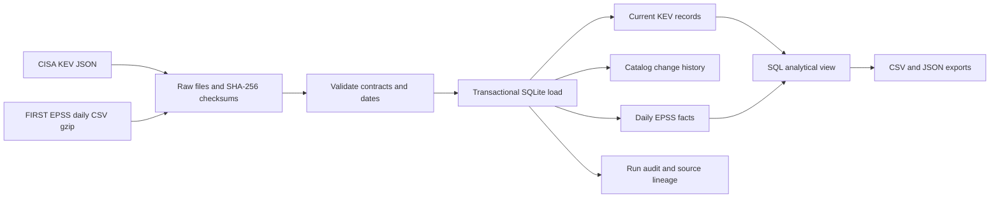

# VulnSignal

### A reproducible vulnerability intelligence warehouse

[](https://github.com/LuciferDataEngineer/kev-risk-observatory/actions/workflows/ci.yml)


**Turn changing public vulnerability feeds into a traceable, queryable data product.** VulnSignal combines CISA's Known Exploited Vulnerabilities (KEV) catalog with FIRST's Exploit Prediction Scoring System (EPSS), preserves source evidence, tracks catalog revisions, and publishes analysis-ready extracts.

This portfolio project covers **data engineering, ETL, database management, and SQL analysis** in one runnable system. Built with AI assistance; the code, tests, source records, and limitations are available for inspection.

## The problem

Security teams encounter two different signals: evidence that a vulnerability has been exploited and a model estimating future exploitation likelihood. Daily source files alone do not show which records changed, whether a score is missing, or which source version produced an analytical result.

VulnSignal creates a small warehouse that can answer:

1. Which active KEV records have a known ransomware association?
2. How much of the catalog has a usable EPSS observation, and how old is it?
3. Which vendors and products dominate the current catalog?
4. What changed between catalog loads, and can a result be traced to original bytes?

**Known exploitation remains actionable even when EPSS is low.** This project does not ingest an organization's asset inventory, infer exposure, or claim that catalog entries represent unpatched company systems.

## Why this topic

FIRST's data documentation records the introduction of EPSS v5 in June 2026. Model-version changes and evolving KEV fields make vulnerability intelligence a useful current example of data contracts, schema evolution, and temporal data management. See [data sources and attribution](docs/SOURCES.md) for the verified references and interpretation rules.

## Architecture



The pipeline fetches the full public snapshots, then performs incremental warehouse updates. It does **not** claim source-side change data capture or real-time streaming.

## Implemented technology stack

| Layer | Technology | Why it is used |
|---|---|---|
| Ingestion and orchestration | Python 3.11+ standard library | A small, readable batch job with no third-party runtime dependencies |
| Network and formats | `urllib`, JSON, CSV, gzip | Direct retrieval of the publishers' public bulk feeds |
| Provenance | SHA-256 and retained raw files | Inspect source bytes and identify repeated snapshots |
| Warehouse | SQLite and SQL | Transactions, relational constraints, history, indexes, and local reproducibility |
| Transformation | Python validation and SQL analytical view | Explicit source contracts and inspectable business rules |
| Delivery | CSV and JSON | Portable extracts usable in BI tools or further analysis |
| Verification | `unittest` | Deterministic tests that do not require internet access |
| Continuous integration | GitHub Actions | Package installation, tests, and an offline example on Python 3.11 and 3.14 |

SQLite is appropriate for this single-writer, laptop-scale project. PostgreSQL, object storage, dbt, and a scheduler are possible extensions, not dependencies or implemented features.

## Run in two minutes

Requires Python 3.11 or later. Commands below work from the repository root on macOS/Linux. The example uses deliberately fictional fixture data and requires no network access.

```bash
git clone https://github.com/LuciferDataEngineer/kev-risk-observatory.git
cd kev-risk-observatory

PYTHONPATH=src python3 -m kev_risk run \
  --data-dir demo-data \
  --as-of 2026-10-29 \
  --kev-file tests/fixtures/kev.json \
  --epss-file tests/fixtures/epss.csv

PYTHONPATH=src python3 -m unittest discover -s tests -v
```

Alternatively, `make demo` and `make test` run the same commands. On Windows, install the package in a virtual environment and use `python -m kev_risk` without `PYTHONPATH`:

```bash
python -m venv .venv
# Activate .venv using the command for your shell.
python -m pip install .
python -m kev_risk --help
```

### Run with live public data

```bash
PYTHONPATH=src python3 -m kev_risk run --data-dir data
```

The run uses the current UTC date by default. `--as-of YYYY-MM-DD` fixes the analytical reference date; it does not download historical source versions. To reproduce an earlier run, pass its saved source files with a compatible as-of date. Live data needs internet access but no API key. EPSS uses the bulk download rather than large numbers of individual API requests.

The warehouse is written to `data/warehouse.sqlite`; outputs are in `data/exports/`. Raw data, local databases, and environment files are excluded from Git. The repository contains synthetic test fixtures and selected execution evidence, with source attribution.

## Data model and definitions

See the [data dictionary](docs/DATA_MODEL.md) for table grain, keys, and temporal semantics, and [SQL examples](sql/analysis.sql) for coverage, ranking, and history queries.

| Dataset | Grain | Purpose |
|---|---|---|
| `pipeline_runs` | One execution attempt | Status, timestamps, as-of date, and error evidence |
| `source_artifacts` | A source artifact recorded for an execution | File location, checksum, and origin |
| `kev_current` | One CVE | Latest observed KEV attributes and catalog membership |
| `kev_history` | One observed state revision per CVE | Historical changes, including removal/reactivation |
| `epss_daily` | CVE and score date | EPSS probability, percentile, and model version |
| `vulnerability_review` | One currently active KEV CVE | Joined analytical fields without multiplying CVE rows |

### Interpretation rules

- **EPSS probability:** estimated probability of exploitation activity in the next 30 days; it is neither severity nor an asset-specific risk measurement.
- **EPSS percentile:** relative position among scored vulnerabilities; it is a separate field from probability.
- **Missing scores:** remain null and visibly marked; they are never converted to zero.
- **Review cohorts:** descriptive groups, not a patch-order recommendation or a validated risk model. Ransomware association and known exploitation must be interpreted alongside local exposure and asset importance.
- **Catalog due dates:** retained source guidance. Elapsed dates are not evidence that an arbitrary organization breached a legal obligation or missed its own patch deadline.
- **History:** records when this pipeline observed a change. It cannot reconstruct changes that occurred between snapshots or before the first load.

## Engineering decisions

- **Repeatable loads:** primary keys and content comparison prevent repeated snapshots from duplicating logical observations or unchanged history. Run audit records still record each attempt.
- **Atomic database changes:** a failed input cannot partially replace the trusted warehouse state.
- **Source evidence:** retained inputs and checksums support replay and investigation.
- **Schema evolution:** unknown KEV attributes are retained so newly introduced fields are not silently discarded.
- **Daily score history:** model version and score date are stored explicitly; older observations are not mislabeled as current.
- **Data contracts:** required fields, uniqueness, dates, and finite probability ranges are checked before loading.
- **Operational visibility:** run status and failure evidence are inspectable separately from business tables.

## Validation and sample outputs

[VALIDATION.md](VALIDATION.md) records the executed offline tests, live-source smoke run, repeat-load checks, and observed environment. Sample output files are in [examples/](examples/). Live source counts change; the dated evidence records one observation, not a permanent claim about either publisher.

| Verified on 29 October 2026 | Result |
|---|---:|
| Offline tests | 26 passed |
| Active KEV records loaded | 1,762 |
| EPSS source records parsed | 396,966 |
| KEV records matched to EPSS | 1,762 |
| Unexpected business-row changes on identical replay | 0 |

CI runs deterministic fixtures on each push and pull request. It does not depend on live publishers being available. A successful fixture test is separate from a successful live data retrieval.

## Operate and recover

See the [operations guide](docs/OPERATIONS.md) for refresh, replay, backup, failure handling, and extension tradeoffs.

This is a batch portfolio implementation with a single writer. There is no hosted service, dashboard, production deployment, multi-user access layer, asset inventory, or automatic patch execution. Source availability and publication cadence are outside this project's control.

## Explain this project in an interview

- Why a left join is necessary when EPSS does not cover every KEV record.
- Why idempotency concerns both warehouse keys and history insertion.
- Why snapshot ingestion is different from source-side CDC.
- How a transaction protects analytical consumers from partial loads.
- Why model versions, observation times, and effective dates should be distinct.
- What would change when moving from a single writer to a production team: PostgreSQL, object storage, managed credentials, orchestration, monitoring, and tested migrations.

## Repository map

```text
src/kev_risk/          Pipeline, database schema, validation and CLI
tests/                Independent integration tests and synthetic fixtures
sql/analysis.sql      Reusable analytical SQL
docs/                 Sources, data dictionary and operations
examples/             Dated execution evidence and sample outputs
.github/workflows/    Reproducible CI checks
```

Original code is [MIT licensed](LICENSE). CISA and FIRST data retain their own terms and attribution requirements; see [SOURCES.md](docs/SOURCES.md).
