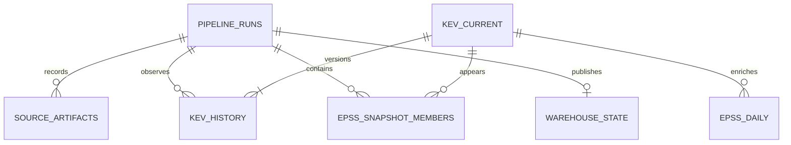

# Data model

The SQLite schema is defined beside the loader in `src/kev_risk/pipeline.py`. Schema version 1 is recorded in `PRAGMA user_version`; unsupported versions fail explicitly. This release initializes a new schema, not a general-purpose migration framework.

## Entities and grain

| Table | Primary key | Grain and important fields |
|---|---|---|
| `pipeline_runs` | `run_id` | An attempt. `started_at`, `finished_at` are UTC timestamps; `as_of` is the analytical date. `status` is running/success/failed. `error` preserves failure context. Source publication metadata and match counts describe a committed load. |
| `source_artifacts` | `run_id`, `source_name` | An input saved for a run. `source_url`, `raw_path`, `sha256`, `byte_size`, and `retrieved_at` provide lineage. Local file replays record a local URI; databases are not committed to Git. |
| `kev_current` | `cve_id` | Latest observed catalog state, including inactive records. Attributes are `vendor`, `product`, `vulnerability_name`, `date_added`, `description`, `required_action`, `due_date`, `ransomware_use`, `notes`, and `extra_json`. |
| `kev_history` | `history_id`; unique `cve_id`, `revision` | An observed state revision. `valid_from` and `valid_to` are pipeline observation timestamps; null `valid_to` means the latest revision. `is_active`, `payload_json`, `row_hash`, and `run_id` preserve the state and provenance. |
| `epss_daily` | `cve_id`, `score_date` | One matched CVE's daily score. `epss` and `percentile` are finite numbers between 0 and 1. `model_version` identifies the scoring model. `run_id` identifies the load that last changed that daily fact. |
| `epss_snapshot_members` | `run_id`, `cve_id` | CVEs matched in an individual EPSS input. Prevents an older score from silently filling an omission in the currently selected snapshot. |
| `warehouse_state` | `singleton` (always 1) | Pointer to the latest successfully committed snapshot, with `run_id`, `as_of`, and `catalog_released`. |

## Catalog state and history

`row_hash` is a SHA-256 digest of normalized catalog attributes, including unmodeled source fields retained in `extra_json`. An unchanged row does not add a history revision. A changed row closes the previous observation interval and opens the next; removal and reactivation also create revisions. A partial catalog whose declared count disagrees with its content is rejected, as is an empty catalog. A publisher-provided nonempty, self-consistent snapshot is treated as authoritative: a large unexpected contraction still warrants human investigation.

`first_seen` and `last_seen` are the analytical dates of first and most recent presence. They are different from `date_added` (CISA's catalog date) and from actual retrieval timestamps. Replaying a source with a later analytical date updates `last_seen` but does not manufacture a source revision.

History is observation history, not a complete historical version of the upstream system. Multiple upstream changes between runs are invisible. Load older KEV versions or earlier analytical dates into a separate directory; the current warehouse rejects regression.

## EPSS facts and analytical view

Only CVEs in the loaded KEV snapshot enter `epss_daily`. Every source record is parsed and checked for valid identifiers and finite probabilities; duplicate detection concerns the matched CVEs. The pipeline does not store all EPSS-scored CVEs. A corrected same-day score replaces that day's fact, while raw source artifacts retain the prior bytes. The daily table therefore is not a bitemporal score-revision ledger.

`vulnerability_review` returns one row per **active KEV CVE**. It joins only the EPSS score day and membership of the selected successful run. A CVE missing from that input stays null even if an older score exists in the warehouse. It does not choose a best-looking score from another day.

| Derived field | Definition |
|---|---|
| `score_status` | `missing` if absent from the selected score snapshot; `stale` if its date is more than 2 calendar days before `as_of`; otherwise `current`. This freshness threshold is a project convention. |
| `review_cohort` | Descriptive categories using known ransomware association first, then missing/stale status, then EPSS ranges ≥0.5, ≥0.1, and lower values. Categories are not a patch-order recommendation. |
| `days_since_added` | Calendar-day difference between `as_of` and CISA `date_added`. |
| `days_past_due` | `max(0, as_of - due_date)` in calendar days, a source-date comparison only. |
| `as_of` | Analytical reference date from the selected successful run. |

All review cohorts retain known exploitation evidence. `Unknown` ransomware association does not mean ransomware use is impossible. Neither vendor counts nor review cohorts establish an organization's exposure.

## Constraints and indexes

Foreign keys link catalog records, score facts, source artifacts, and run evidence. The partial unique index on open history rows permits one current revision per CVE. Other indexes support vendor/active filters, catalog addition dates, and score-date queries. SQLite WAL and a busy timeout support normal local reads, but this implementation requires one scheduled writer. It does not provide distributed locking or multi-writer orchestration.

## Transaction boundary

The run-audit row and downloaded-source metadata are committed before validation/loading so failures remain inspectable. Catalog mutations, history changes, EPSS facts/membership, warehouse pointer, and success status commit together. Derived CSV and JSON files are written after that commit with individual atomic replacements. They are not a multi-file transaction: an export failure can leave older/mixed exports while the database is valid. The run's error field and a nonzero command exit distinguish this case; replay regenerates exports.
